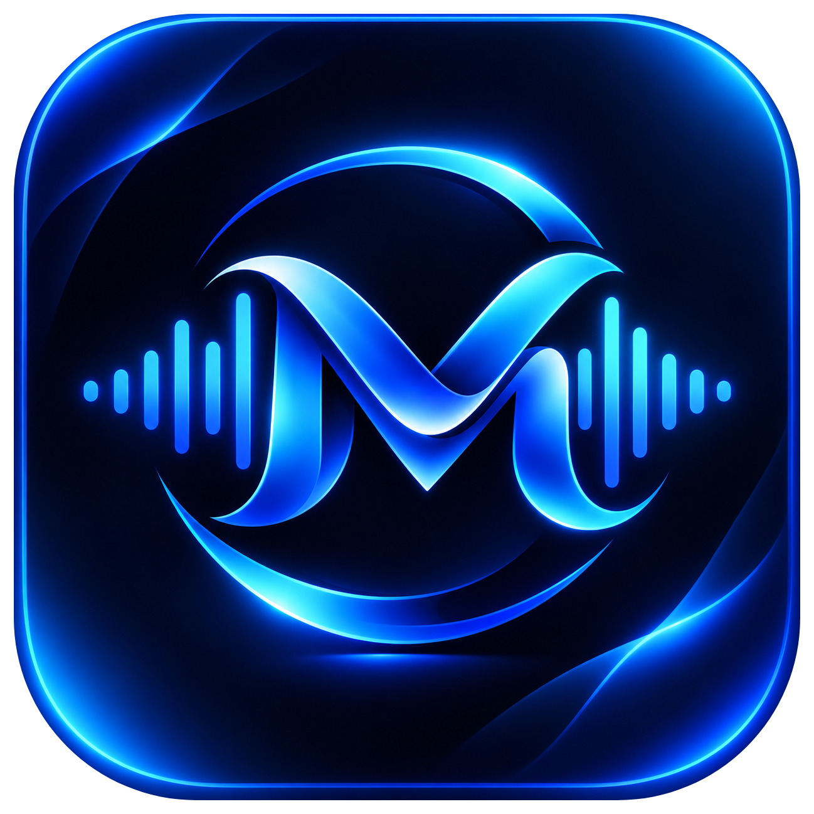
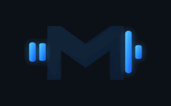
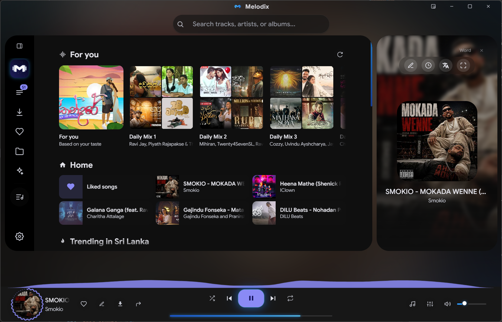
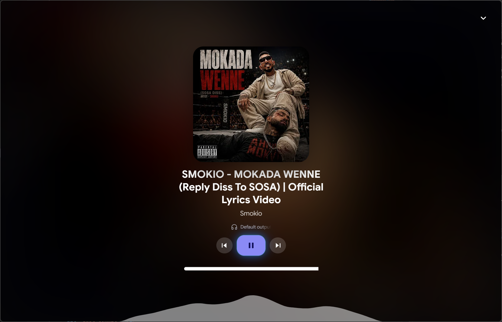
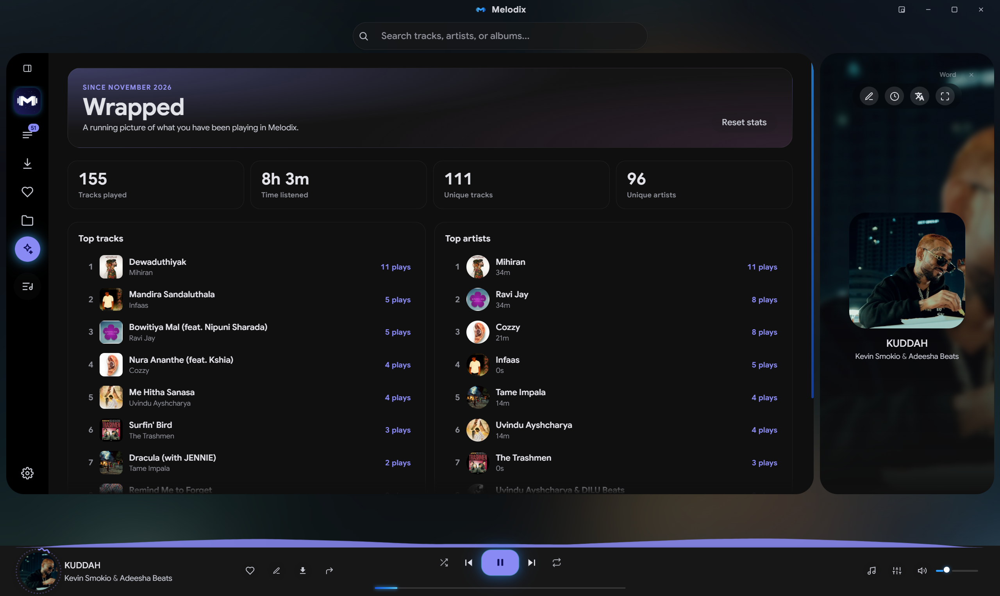
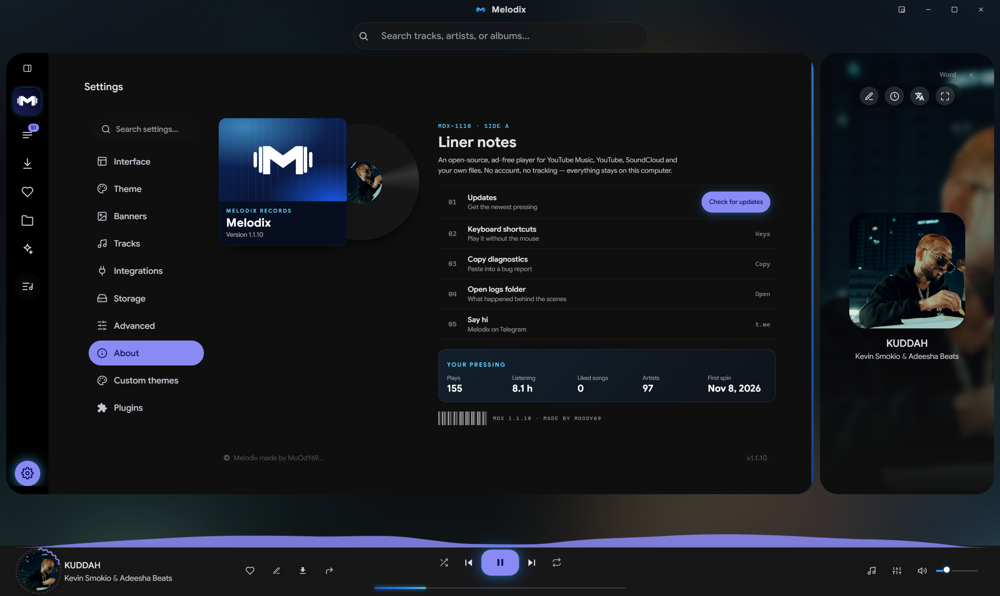

<p align="center">
  
</p>

<p align="center">
  <h1 align="center">
  &nbsp;Melodix
</h1>
</p>

<p align="center">
  <b>Your Music. Your World.</b><br>
  A free, open-source desktop music player for YouTube Music, SoundCloud, and local files.<br>
  Built with Material Design 3, no tracking, and no account needed.
</p>

<p align="center">
  <a href="https://github.com/InoshMatheesha/MeloDiX-YourMusic.YourWorld/releases/latest">
    
  </a>
  &nbsp;
  <a href="https://github.com/InoshMatheesha/MeloDiX-YourMusic.YourWorld">
    
  </a>
</p>

<p align="center">
  <a href="#whats-new">What's new</a> &nbsp;·&nbsp;
  <a href="#core-features">Features</a> &nbsp;·&nbsp;
  <a href="#built-in-audio-suite">Audio Suite</a> &nbsp;·&nbsp;
  <a href="#material-design-3-expressive-ui">Interface</a> &nbsp;·&nbsp;
  <a href="#download-and-install">Install</a> &nbsp;·&nbsp;
  <a href="#faq">FAQ</a> &nbsp;·&nbsp;
  <a href="#build-from-source">Build</a>
</p>

<p align="center">
  <a href="https://github.com/InoshMatheesha/MeloDiX-YourMusic.YourWorld/stargazers"></a>
  <a href="https://github.com/InoshMatheesha/MeloDiX-YourMusic.YourWorld/commits/main"></a>
  <a href="https://github.com/InoshMatheesha/MeloDiX-YourMusic.YourWorld/blob/main/LICENSE"></a>
  <a href="https://ko-fi.com/rootlesszen"></a>
</p>

---

## What is Melodix?

Melodix is a desktop music player that brings streaming and local playback into one
place. Search across YouTube Music, YouTube, SoundCloud, Spotify and Yandex Music,
play what you find, build playlists, read synced lyrics, and keep a library of your
own files — all from a single Material Design 3 window.

There is no account, no sign-up, and no telemetry. Your playlists, settings and
downloads stay on your machine.

> **Note on streaming sources.** Melodix searches public catalogues and plays
> publicly available audio streams. It is a player, not a subscription service, and
> it does not bypass paid tiers or DRM. Please respect the terms of service of each
> platform and the rights of the artists you listen to.

---

## What's new

**v1.1.14**
- The glow around the active sidebar button (Settings, at the bottom of the collapsed sidebar) is no longer cut off. It is now a soft halo in your accent colour.

**v1.1.13**
- **Updates work again.** *Check for updates* found new versions but the update window stayed invisible. It now shows, and **Update** installs and reopens Melodix on its own.
- A small **Update available** pill appears at the top right of Home when a new version is out. Nothing pops up by itself.
- **Later** installs the update quietly the next time you close the app.

**v1.1.12**
- **Drag to reorder** in the Queue, Liked songs and playlists now behaves like Spotify: drag to the edge and the list scrolls with you, and the track stays where you drop it.
- Visualizer and shaped-cover settings moved out of Advanced into one compact card under **Settings → Tracks**.

**v1.1.11**
- A much fuller **Home page**: *Because you listened to…*, *On repeat*, *New releases*, regional charts and genre shelves.
- **Play next** in the right-click menu.
- Reorganised Settings. Plugins and custom theme files were removed.

---

## Core features

| | |
| :-- | :-- |
| **Multi-source search** | One search bar over YouTube Music, YouTube, SoundCloud, Spotify and Yandex Music. Pick your default engine in Settings. |
| **Local library** | Point Melodix at a music folder and it indexes your own files alongside everything else. Albums, artists and a dedicated **My files** tab. |
| **Home page** | Rows that fill themselves from your listening: *For you* mixes, *Because you listened to…*, *On repeat*, your top artists and artists you might like, plus *New releases*, regional charts and genre shelves. |
| **Playlists & queue** | Create and delete playlists, and drag tracks to reorder them in playlists, Liked songs and the queue. Right-click any song for **Play next** or **Add to queue**. |
| **Import & export** | Import playlists from **Spotify**, **Apple Music**, a plain link, or JSON. Export all playlists to JSON, or your whole profile as a portable `.mdacc` account file. |
| **Synced lyrics** | Online lyric lookup with auto-scroll, word-by-word highlighting, a **custom lyrics editor**, and auto-translation into your language. |
| **TV Karaoke mode** | Full-screen karaoke with word highlighting and an optional visualizer behind the words. |
| **Downloads** | Save tracks as **MP3**, **FLAC** or **M4A**, with a *Trim best part* mode for clips. Choose your own download folder. |
| **Offline library** | Keep downloaded tracks available with no connection at all. |
| **My Wave** | Recommendations built from what you actually listen to, plus a personal **Wrapped** view with top tracks and artists. |
| **Mini player** | A compact, always-handy player — press <kbd>P</kbd>. |
| **Discord Rich Presence** | Show what you are playing on your Discord profile, with an option to include the artist. |
| **Last.fm scrobbling** | Scrobble your listens to Last.fm. |
| **Sleep timer** | Fade out and stop after a set time. |
| **Tray & media keys** | Minimize to tray on close, and full media-key support, including a legacy capture mode for Windows. |
| **Blocklist** | Mute artists and tracks you never want to hear again. |
| **In-app updates** | Melodix checks for new releases in the background and shows a small **Update available** pill on Home. One click installs and reopens the app (Windows installer and Linux AppImage). |

---

## Built-in audio suite

Melodix ships a full Web Audio processing chain, so you can shape the sound without
any external tools.

- **10-band equalizer** — 32 Hz to 16 kHz, with savable, renamable custom presets and smooth preset transitions.
- **High Quality mode** — a mastering chain with **Bass Depth**, **Vocal Clarity**, **High-End Air**, saturation and a limiter.
- **Effects** — Reverb, Echo, Distortion, and independent **Speed**, **Tempo** and **Pitch** control.
- **Volume normalization** — even out loudness across tracks, with its own limiter.
- **Crossfade** — smooth transitions between tracks.
- **Volume gain** — push past 100% when a track is mastered quietly.
- **Audio output device** — send playback to a specific output.
- **Live visualizer** — pick from `bars`, `liquid`, `mirror`, `peaks`, `LED`, `neon`, `aurora` and `orbit`. Opacity, sensitivity and smoothness for the playbar and karaoke visualizers live together under **Settings → Tracks → Visualizer & cover tuning**.

---

## Material Design 3 Expressive UI

The interface is built on Material Design 3 and is unusually deep in what it lets
you change:

- **Theme** — light / dark / system, a custom **accent color**, palette style, hue, brightness and intensity.
- **Dynamic color** — a mesh gradient and ambient light that can take their colors from the current cover art.
- **Banners** — per-track banners with blur, fade, fit, opacity and custom effects; use images or video as background media.
- **Covers** — eleven cover shapes (morph, circle, squircle, cookie, flower, star, heart and more) for the bottom bar, Now Playing and karaoke.
- **Settings** — grouped into *Personalize*, *Listening*, *Connections* and *System*, with a search box that finds any option.
- **Layout** — rearrange the sidebar and home page, switch to a classic sidebar, move the search bar, hide the titlebar, or hide the engine buttons.
- **Typography & scale** — interface font, font scale and overall UI scale.
- **Progress bar** — wavy or plain, with custom knob and background styling.
- **Accessibility** — reduce motion, a **Performance mode** for lower-end machines, a *No-Hand* cursor mode, interface opacity, and full right-to-left layout support.
- **132 interface languages** — the UI auto-translates, including RTL languages such as Arabic, Persian, Hebrew and Urdu.
- **CSS editor** — a built-in editor under **Settings → Advanced** for live-tweaking the interface.

---

## Screenshots

<p align="center">
  
</p>
<p align="center">
  <b>Home</b> — <i>For you</i> and Daily Mixes built from your listening, with the lyrics panel docked beside the player.
</p>

<table>
  <tr>
    <td width="50%"></td>
    <td width="50%"></td>
  </tr>
  <tr>
    <td align="center"><b>Now Playing</b><br><sub>Full-screen cover view with ambient color pulled from the artwork</sub></td>
    <td align="center"><b>Wrapped</b><br><sub>A running picture of your listening — top tracks, top artists and totals</sub></td>
  </tr>
</table>

<p align="center">
  
</p>
<p align="center">
  <b>Settings</b> — the About page, styled as a record sleeve, with updates, shortcuts, diagnostics and your listening stats.
</p>

---

## Download and install

Grab the latest build from the
**[Releases page](https://github.com/InoshMatheesha/MeloDiX-YourMusic.YourWorld/releases/latest)**.

| Platform | File | Notes |
| :-- | :-- | :-- |
| **Windows** (x64) | `moodex-<version>-win-x64-setup.exe` | One-click installer. Your data is kept if you uninstall. |
| **Windows** (portable) | `moodex-<version>-win-x64-portable.exe` | No install — just run it. |
| **Linux** (x64) | `moodex-<version>-linux-x64.AppImage` | `chmod +x` then run. In-app updates work from the AppImage. |
| **macOS** (Intel / Apple Silicon) | `Moodex-<version>-mac-<arch>.dmg` | Unsigned build — see the FAQ below. |
| **Nix / NixOS** | — | See [NIX.md](NIX.md) for the flake, overlay and dev shell. |

### Required tools

Downloading and converting tracks needs **yt-dlp** and **ffmpeg**. You do not have
to install them by hand:

> **Settings → Required tools → Install**

Melodix downloads both into its own folder and verifies the checksum. If you would
rather manage them yourself, put the binaries on your `PATH` or drop them into the
app's `bin/` folder.

### Where your data lives

| OS | Location |
| :-- | :-- |
| Windows | `%LOCALAPPDATA%\Moodex` |
| macOS | `~/Library/Application Support/Moodex` |
| Linux | `~/.config/devsize` (config) and `~/.cache/devsize` (data) |

Set `MOODEX_DATA_DIR` to move it somewhere else.

---

## Keyboard shortcuts

| Action | Shortcut |
| :-- | :-- |
| Play / Pause | <kbd>Space</kbd> |
| Next / Previous | <kbd>Ctrl</kbd> + <kbd>→</kbd> / <kbd>←</kbd> |
| Seek ±5 s | <kbd>Shift</kbd> + <kbd>→</kbd> / <kbd>←</kbd> |
| Volume ±5% | <kbd>Ctrl</kbd> + <kbd>↑</kbd> / <kbd>↓</kbd> |
| Mute / Unmute | <kbd>M</kbd> |
| Shuffle | <kbd>H</kbd> |
| Repeat | <kbd>R</kbd> |
| Lyrics | <kbd>L</kbd> |
| TV Karaoke | <kbd>F</kbd> |
| Mini player | <kbd>P</kbd> |
| Search | <kbd>/</kbd> or <kbd>Ctrl</kbd> + <kbd>K</kbd> |
| Close / Blur | <kbd>Esc</kbd> |

---

## Customizing with CSS

Plugins and custom theme files were removed in v1.1.11. For your own tweaks, use the
built-in **CSS editor** in **Settings → Advanced**. Melodix sets its colours from
JavaScript, so add `!important` to override them:

```css
:root { --md-sys-color-primary: #8EEDD8 !important; }
```

If a tweak breaks the layout, <kbd>Ctrl</kbd> + <kbd>Shift</kbd> + <kbd>R</kbd>
turns all custom CSS off.

---

## Build from source

You need **Node.js 18+** and **git**.

```bash
git clone https://github.com/InoshMatheesha/MeloDiX-YourMusic.YourWorld.git
cd MeloDiX-YourMusic.YourWorld
npm install
npm start
```

### Other commands

| Command | What it does |
| :-- | :-- |
| `npm start` | Run the app from source. |
| `npm test` | Run the test suite (`node --test`). |
| `npm run dist` | Build installers for your platform into `dist/`. |
| `npm run release` | Bump the patch version and push the tag, which triggers the release workflow. |

### Publishing a release by hand

If the GitHub Actions release workflow can't run, build on Windows and publish with
the [GitHub CLI](https://cli.github.com/). The in-app updater needs `latest.yml`, the
setup `.exe` and its `.blockmap` on the release:

```bash
npm version patch                     # bump the version and create the tag
git push origin main v<version>       # push the commit and that tag
npx electron-builder --win --publish never
gh release create v<version> --latest --title "MeloDiX v<version>" --notes "..."   dist/latest.yml dist/moodex-<version>-win-x64-setup.exe   dist/moodex-<version>-win-x64-setup.exe.blockmap dist/moodex-<version>-win-x64-portable.exe
```

Installed copies then pick up the new version on their own (shown as the
*Update available* pill on Home), or straight away from
**Settings → About → Check for updates**.

### Project layout

```
src/
  main/       Electron main process — window, CLI, updater, Discord RPC
  renderer/   The UI — app.js, audio.js (Web Audio chain), shapes.js, styles.css
  server/     Local backend — search, streaming, yt-dlp/ffmpeg management
  shared/     Cross-process helpers — paths, logging, audio output
assets/       Icons, logo and the built-in cover shapes
web/          Browser build layer — Electron bridge shim, mobile CSS, service worker, PWA manifest
api/          Vercel function that serves src/server for the web build
scripts/      build-web.js (builds web-dist/) and serve-web.js (runs it locally)
test/         Unit tests
```

### CLI

```bash
moodex lyrics   # stream the current track's lyrics to your terminal
```

---

## Web version (Vercel)

The same app also runs in a browser on Windows, macOS, Linux, Android and iOS,
and can be installed to the home screen as an app (PWA). It reuses the desktop
renderer and server unchanged. `scripts/build-web.js` swaps the Electron bridge
for a browser shim and adds a phone layout: search at the top, a bottom tab bar,
a mini player, and a full-screen Now Playing sheet.

```bash
npm run web          # build web-dist/ and serve it at http://localhost:3000
```

**Deploy:** import the repository in Vercel. `vercel.json` sets the build command,
output folder and API function, so no settings are needed.

What differs from the desktop app:

- **Audio source.** Vercel has no yt-dlp, and YouTube blocks datacenter IPs. Tracks
  therefore play from a matching SoundCloud upload, picked by title and length.
  For full YouTube playback, run `npm run web` on your own machine or a VPS that
  has yt-dlp installed. That server then uses yt-dlp the same way the desktop app does.
- **Storage.** Playlists and settings stay in the browser. Files you add from
  **Library** are kept in the browser's storage and work offline. `.mdacc` account
  files work in both directions, so you can move your desktop profile to the web.
- **Desktop-only, hidden on the web:** downloads, Discord, tray, auto-update,
  Google sign-in, Spotify account login (public playlist import still works),
  proxy settings and folder scanning.
- **iOS:** add the app to the home screen for full-screen use. Safari may pause
  audio that goes through the equalizer while the screen is locked.

---

## FAQ

<details>
<summary><b>Do I need an account?</b></summary>

No. There is no sign-up and no login. Spotify and Apple Music are used only to
*import* playlists you already have.
</details>

<details>
<summary><b>Does Melodix track me?</b></summary>

No telemetry, no analytics, no ads. Playlists, settings and downloads are stored
locally. The only network traffic is to the music sources, lyric providers, and the
GitHub releases endpoint for updates — plus Discord and Last.fm if you turn those on.
</details>

<details>
<summary><b>macOS says the app is damaged or from an unidentified developer.</b></summary>

The macOS builds are unsigned, because code-signing requires a paid Apple developer
account. Right-click the app → **Open**, or run:

```bash
xattr -cr /Applications/Moodex.app
```
</details>

<details>
<summary><b>Downloads or playback fail.</b></summary>

Almost always missing or outdated tools. Open **Settings → Required tools** and
reinstall **yt-dlp** and **ffmpeg** — yt-dlp in particular needs regular updates as
sites change. If a specific source is blocked on your network, try the
**In-app proxy** option in Settings.
</details>

<details>
<summary><b>The app feels slow or stutters.</b></summary>

Turn on **Performance mode** and **Reduce motion** in Settings, and lower or disable
the visualizer, mesh gradient and banner effects.
</details>

<details>
<summary><b>How do I move my library to another machine?</b></summary>

**Settings → Export Melodix account (.mdacc)**, then import that file on the other
machine. Playlists alone can be exported as JSON.
</details>

---

## Contributing

Issues and pull requests are welcome.

1. Open an [issue](https://github.com/InoshMatheesha/MeloDiX-YourMusic.YourWorld/issues) first for anything substantial — there are bug report and feature request templates.
2. Fork, branch, and keep changes focused.
3. Run `npm test` before opening a PR, and fill in the pull request template.

---

## License

Released under the [MIT License](LICENSE).

---

## Credits and thanks

Melodix would not exist without the work it is built on.

### 🙏 Thanks to the original creator

Melodix is a customized build of **[Riff](https://github.com/rootscripts/riff)** by
**[rootscripts](https://github.com/rootscripts)**, who released the source code that
made this project possible. The entire foundation of this player — its architecture,
its audio engine and its Material Design 3 interface — comes from that work.

Thank you for making it open source. 💜

> If you like Melodix, please go star the original project:
> **[github.com/rootscripts/riff](https://github.com/rootscripts/riff)**

### Built with

- [Electron](https://www.electronjs.org/) — the desktop shell
- [Tone.js](https://tonejs.github.io/) — audio processing
- [hls.js](https://github.com/video-dev/hls.js) — adaptive streaming
- [yt-dlp](https://github.com/yt-dlp/yt-dlp) and [ffmpeg](https://ffmpeg.org/) — media fetching and conversion
- [electron-builder](https://www.electron.build/) and [electron-updater](https://www.electron.build/auto-update) — packaging and updates
- [discord-rpc](https://github.com/discordjs/RPC) — Rich Presence
- [Material Design 3](https://m3.material.io/) — the design language

---

<p align="center">
  <br>
  <b>Melodix</b> — Your Music. Your World.<br>
  <sub>Made with 💜 by <a href="https://github.com/InoshMatheesha">Inosh Matheesha</a> · based on <a href="https://github.com/rootscripts/riff">Riff</a> by rootscripts</sub>
</p>

<p align="center">
  <a href="https://ko-fi.com/rootlesszen"></a>
</p>
